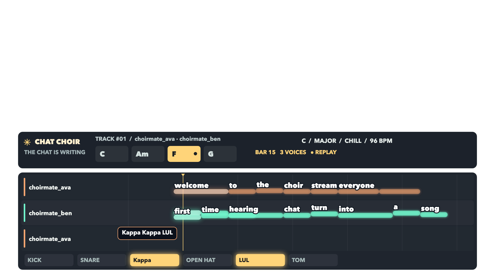
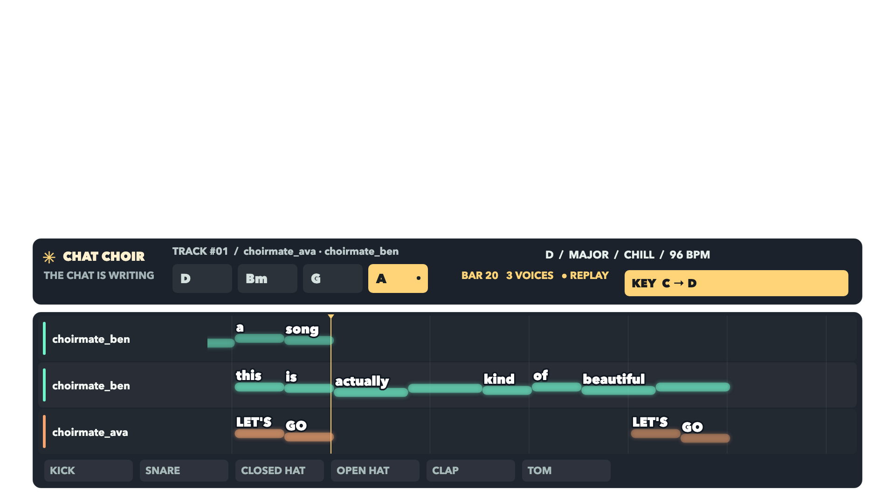
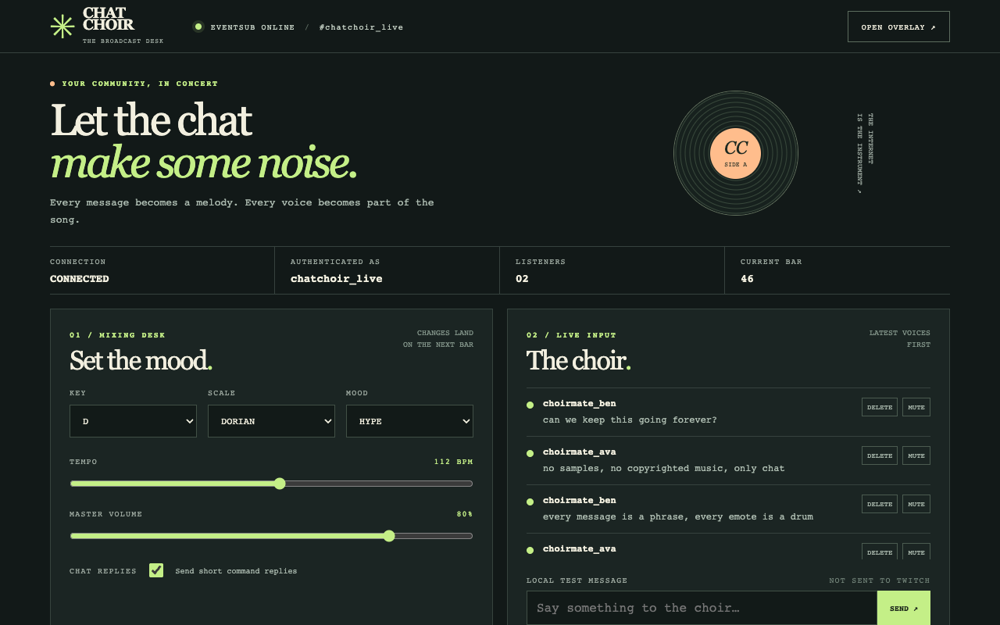

# Chat Choir

**Your community, in concert.** Chat Choir turns a Twitch channel's chat into a live band: every message becomes a short melody, every emote becomes percussion, and the chat's words ride the notes in a stream overlay. The sound is synthesized from scratch without samples or third-party songs, helping streamers avoid relying on licensed background tracks that can cause VOD mutes.

- A transparent, scrolling piano-roll browser source with lyrics, chord changes, animated arrivals, moderation effects, and celebration bursts.
- A broadcast desk for key, scale, mood, tempo, volume, chat replies, moderation, local testing, and exports.
- A deterministic shared music engine and nine synthesized instrument plugins; browser playback and the offline renderer use the same sample-generating code.
- Session recording, credential-free replay, MIDI and lyric-sheet downloads, and offline WAV rendering.
- Chat commands and community voting put the audience in the conductor's chair.

## In action

These screenshots come from a real Twitch session with test accounts. The overlay frames were rendered from its recorded log with the manual clock; the broadcast desk was captured live:





## Requirements

Node 22 or newer, npm, a modern browser or OBS Browser Source, and an internet connection for live Twitch. Runtime dependencies are Node built-ins and `ws`; there is no build step, paid API, audio asset, or Twitch client secret.

```sh
npm install
npm test
```

If necessary, put Homebrew Node on PATH with `export PATH=/opt/homebrew/bin:$PATH`.

## Run it with Twitch

1. Register an application at [Twitch Developer Console](https://dev.twitch.tv/console/apps). Choose **Public** client type and add `http://localhost` as an OAuth redirect URL. Copy the client ID.
2. Copy `.env.example` to `.env`, set `TWITCH_CLIENT_ID`, and optionally set `TWITCH_CHANNEL` to a channel login. With no channel, Chat Choir joins the account that authorizes the app.
3. Run `npm run login`. Open the displayed Twitch verification URL, enter the displayed code, and authorize the requested chat, follower, and hype-train scopes. No client secret is needed.
4. Run `npm start`, then open **http://127.0.0.1:3000/** for the broadcast desk.
5. In OBS, add a Browser Source at **1920 × 1080** using `http://127.0.0.1:3000/overlay.html?autostart=1`. Enable **Control audio via OBS**. The overlay is transparent by default. Use the on-screen sound button if your browser blocks autoplay.

The server listens on `127.0.0.1` only. A Twitch user token is stored locally with mode `0600` in `.data/tokens.json` and refreshes automatically; session logs and first-seen user IDs also stay under `.data` by default. These files contain private account or chat data and should not be shared. `TWITCH_CHANNEL` can name another channel, but follow/hype subscriptions may require broadcaster or moderator authorization and will be skipped with a warning if unavailable.

Options in `.env.example`: `PORT` (default 3000), `CHOIR_REPLIES` (0/1, default 1), `CHOIR_VOTES` (1–20, default 3), `CHOIR_VOTE_WINDOW_SECONDS` (positive seconds, default 60), `CHOIR_NO_TEST` (1 disables local test messages), `IGNORE_USERS` (comma-separated logins), and `SESSION_DIR`. `TWITCH_ID_BASE`, `TWITCH_API_BASE`, and `TWITCH_EVENTSUB_URL` override endpoints for testing.

## Try it without Twitch

```sh
npm run replay -- samples/demo-session.json
# optional: play the timeline twice as fast
npm run replay -- samples/demo-session.json --speed 2
```

Open the same dashboard and overlay URLs. The example is hand-written synthetic chat, and both screens show a **REPLAY** badge. Replay needs no Twitch credentials. The dashboard's local test box inserts a clearly marked message into the local session and overlay; it does not send that message to Twitch. The `demo/` folder also includes a real session recorded with two test accounts, plus its MIDI and lyric-sheet exports.

```sh
npm run render -- samples/demo-session.json /tmp/choir.wav
npm run render -- recording.jsonl /tmp/choir-raw.wav --no-normalize
```

The renderer writes 44.1 kHz 16-bit stereo WAV, starts its timeline at the first recorded event, and defaults to a soft-limited peak of approximately −1 dBFS. A session whose first chat arrives exactly at time zero starts that phrase on the opening downbeat; later entries retain their recorded timing and bar quantization. It accepts JSON arrays or JSONL logs. The dashboard downloads format-1 MIDI, an attributed lyric sheet, and the JSONL session log. MIDI approximates audio fades as shortened notes and uses the nearest major/minor key signature for other modes.

## Frame-exact video capture

Install the Playwright Chromium browser if it is not already cached (`npx playwright install chromium`). `PLAYWRIGHT_CHROMIUM_EXECUTABLE` can point to a compatible Chromium binary when the default lookup does not work.

```sh
npm run capture -- recording.jsonl /tmp/choir-frames --fps 30 --from 0 --to 10000
npm run render -- recording.jsonl /tmp/choir.wav
npm run smoke
```

Capture writes transparent `frame-000000.png`, `frame-000001.png`, and so on into an output directory without existing capture frames (to avoid accidentally mixing old and new frames). `--from` and `--to` are milliseconds relative to the first recorded event; the interval is `[from, to)`. Omit `--to` to capture through the arrangement's tail. WAV sample zero and capture frame zero both represent the timestamp of the first event in the input. For a nonzero `--from`, trim the same amount from the start of the WAV when combining them. Any genuine rest between that event and the first note is preserved. The capture command runs a temporary localhost server, without Twitch credentials or audio playback.

For custom renderers, `/overlay?clock=manual` disables WebSocket updates, timers and audio. Call `window.__choir.loadSession(eventsArray)` and then `window.__choir.seek(ms)` to synchronously draw a single frame at an **absolute session timestamp**. `/overlay?clock=manual&session=/export-session.jsonl` loads a JSONL log from a server path; `window.__choir.sessionLoaded` becomes true when it is ready. Repeated and backward seeks reconstruct the same pixels in the same browser. Manual rendering uses the original event history and never needs a live server connection after the page and modules load.

`npm run smoke` is separate from the fast unit suite. It runs a temporary replay in headless Chromium, checks scheduled notes, the running AudioContext and non-silent master analyser, verifies repeated manual seeks, and refreshes seven screenshots in `docs/screenshots/`. The celebration image uses an explicitly synthetic raid event.

## How the choir plays

Messages are stripped of URLs and @mentions, then words become notes based on estimated syllable counts; long words split into two notes. Emotes become grid-aligned percussion. A stable user-ID hash selects voice and pan. The overlay uses Twitch colors when supplied, and otherwise assigns golden-angle hues by first appearance; dark colors are lightened for legibility. New melodic plugins use rendezvous scoring against a compatibility group for the original five voices, so adding a plugin changes only the users assigned to that plugin. Moderators play bass, subscribers play pad and chords, broadcasters lead, and VIPs play bells. First-time participants get a welcome arpeggio. Phrases begin on the next bar (or the opening downbeat for a first message at time zero), loop with decreasing gain, and conform to the active key and chord. `?` phrases rise without resolving; `!` phrases jump and accent. Messages have a four-second per-user cooldown and the arrangement has phrase and note budgets. Deletions, clears, and dashboard mutes fade affected voices out.

Try `!key D`, `!key F# minor`, `!scale dorian`, `!tempo 96`, `!mood hype`, or `!choir`. Broadcasters and moderators authorize changes directly; other viewers need distinct votes for the same value within the configured window (by default, 3 votes within 60 seconds). `!choir` and vote replies show the current threshold. The authenticated bot account’s own messages are ignored by user ID. Music settings change on the next bar; chat replies are globally limited to one every three seconds.

Overlay parameters: `bg=dark`, `scale` (0.45–1.5), `position=top|bottom|full`, `volume` (0–1), `lyrics=0|1`, and `autostart=1`. For example: `/overlay.html?bg=dark&position=top&volume=0.6`. `window.__choir` exposes the current snapshot, recent events, audio context time and state, master analyser peak, and scheduled-note count for debugging.

## Demo recording

The `demo/` folder holds the material from one real Twitch session on `twitch.tv/chatchoir_live` with two test accounts (`choirmate_ava`, `choirmate_ben`) sending 16 chat messages through the Twitch API:

- `demo/chat-choir-demo.mp4`: the 2:27 demo video (the live-chat footage is real Twitch chat; the overlay is rendered frame by frame from the recorded log; the Codex section is a sped-up replay of the real Codex rollout).
- `demo/live-session.jsonl`: the recorded session log. Try it: `npm run replay -- demo/live-session.jsonl` or `npm run render -- demo/live-session.jsonl /tmp/live.wav`.
- `demo/live-session.mid` and `demo/live-session-lyrics.txt`: the exports the dashboard produces for that session.
- `demo/screenshots/`: stills from the real session.

The session shows four community votes (two votes each) changing key, scale, mood and tempo, and the bot's vote replies in Twitch chat. Moderation deletes were exercised through tests and replay, not on live Twitch.

## Codex and the judging criteria

**Codex session ID: `01a18e4f-931d-7322-98f6-a9415b2c8960`.** All of the application code, tests and docs under `src/`, `public/`, `scripts/` and `docs/` were written by OpenAI Codex (Codex CLI, model `gpt-6.1-terra`) in this one thread: the first prompt through `codex exec`, then six follow-ups through `codex exec resume` on the same session. The prompts were mine, written as short specs (product description, module list, hard requirements such as one shared deterministic synth, instruments as plugins, tests next to every module). What Codex did with them:

1. **Offline core:** theory, text-to-phrase mapping, the arrangement engine, chat commands, eight-instrument synth plumbing, MIDI export and the WAV renderer, with 19 tests.
2. **Twitch and browser:** device-code OAuth for a public client, an EventSub WebSocket client with reconnect and keepalive handling, Helix chat replies, the local server, session log and replay, and the first overlay and broadcast desk.
3. **Looking at its own output:** Codex drove headless Chromium, took screenshots of the overlay and desk, opened them with its image viewer (85 image views over the session) and changed spacing, label clipping and contrast based on what it saw. It also added the manual clock and frame capture used for the demo video.
4. **A real Twitch run:** I connected two test accounts to a real channel, fed the recorded log back to Codex, and it fixed what it could see in the live frames (truncated names, near-identical colours, thin lanes, missing setting-change banners). The same log is committed as `demo/live-session.jsonl`.
5. **Configurable votes and bot echoes:** `CHOIR_VOTES` and `CHOIR_VOTE_WINDOW_SECONDS`, and the authenticated account's own replies are never ingested.
6. **Plugin test:** I asked for a steel pan instrument using the recipe below. Codex added one file, made voice assignment stable when a plugin is added, added an audition command, and the conformance tests picked the new instrument up without edits.
7. **Release hygiene:** a secrets and path audit, full-text lyric export, package metadata and a clean-clone `npm ci && npm test` run.

The session ended with 17 commits, 56 passing tests and 137 shell commands run by Codex. The demo video, its narration and the scripts that assemble it were made outside Codex; the video's Codex section is a replay of the real rollout file, sped up.

- **Innovation / idea:** chat text becomes a harmonized, evolving composition rather than a queue of requested songs.
- **Potential impact:** communities hear their own contributions; synthesis removes the need for licensed samples, and moderation can remove a phrase from the music.
- **Technical implementation / Codex:** a deterministic shared engine, testable plugins, EventSub reconnects, event-log reconstruction, exports and offline replay create a foundation Codex can extend.
- **Design:** a legible broadcast desk and animated lyric piano roll make the collective performance visible and fun to watch.

## Add an instrument with Codex

Ask Codex, for example: “Add a steel drum instrument to Chat Choir.” Create an ES module in `src/synth/instruments/` exporting `id`, `name`, `role` (`melodic`, `bass`, `pad`, or `percussion`), and `render(note, sampleRate)`. Return a deterministic, non-silent `Float32Array` with finite samples, peak at or below 1, and a near-silent tail. `note` contains MIDI pitch, duration in seconds and optional drum name. Use seeded noise from `dsp.js`, never `Math.random` or audio assets. Keep the module browser-compatible. The generated registry discovers every `.js` plugin during install, test, start, render and replay; commit the regenerated `registry.generated.js`. The conformance test covers every plugin. Run `npm run preview -- steelpan /tmp/steelpan.wav` to audition any instrument ID with a short D dorian phrase (the drums plugin previews its drum sounds). Run the full tests and listen to a render.

## Limitations

Twitch subscriptions depend on the authorized account's scopes and relationship to the selected channel; unsupported subscriptions are skipped. The browser can require an audio-enabling click. Playback uses the shared synthesized samples, while browser compression and offline reverb/normalization differ, so the live mix is not a bit-identical WAV. Browser scheduling and network latency can cause small timing differences across clients. Session files grow with chat activity, and exports include chat text and usernames. Localhost has no multi-user authentication: anyone with access to the computer can operate the dashboard. PNG output is deterministic for a fixed browser, installed fonts and viewport; font and graphics rendering can vary between machines. This is a hackathon prototype, not a guarantee against all copyright claims.

See [architecture](docs/ARCHITECTURE.md) and [Codex conventions](AGENTS.md).
